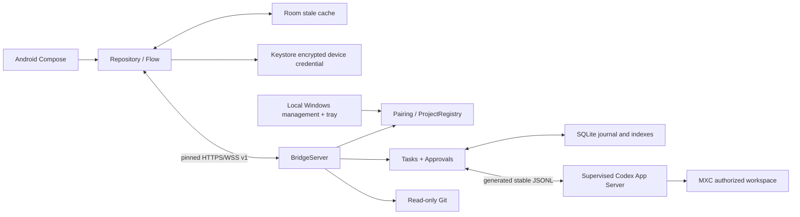

# Architecture

The first production launch binds loopback. A Windows-local QR action may save an exact private interface address; production restart restores it only while assigned and certified. No remote action can change that listener grant. The Codex child environment excludes Desktop cached PowerShell and MSIX alias paths that Windows MXC cannot execute; this does not alter the parent PATH, user login/configuration, or sandbox permissions.

## Components

Windows Bridge runs in the logged-in user's foreground session. Three .NET Framework helpers compile from reviewed C# sources on first use. DPAPI helper input is stdin, never an argument. Certificate creation uses Windows CNG RSA 3072/SHA-256. The WinForms process reads a bounded local JSON channel and emits only validated local management actions. It has no network listener.

The Windows window has no system title bar or sidebar. Home combines Windows-local workspace sync with QR pairing; secondary management lives in the more menu. Sync discovers trusted config directories and paginated interactive thread cwd through stable config/read and thread/list, validates and deduplicates paths, then grants them only on the explicit local action. Desktop-only projects absent from these records cannot be enumerated. Sync is additive and never available over WSS. Snapshots refresh every two seconds and on durable changes; lists preserve selection and scroll. Device presence requires authenticated hello. Approval review shows full retained context, rechecks expiry after confirmation and disables duplicate submissions; the backend remains the exactly-once authority. Confirmation defaults to cancel. See DESKTOP_EXPERIENCE.md.

`packages/protocol` defines independent strict AgentDeck requests. Android never sends raw Codex RPC or filesystem paths. Project addition opens the native folder selector; Android can only request that local action. A session binds a project ID to one upstream thread. A turn binds one local turn ID to its upstream turn ID. Two active sessions are allowed; reservations are acquired before asynchronous starts.

## Sources of truth

Codex is authoritative for execution state. `turn/start` only acknowledges submission. Only schema-validated `turn/completed` or a validated persisted turn from `thread/turns/list` establishes completed/failed/interrupted. An upstream crash or Bridge restart yields **unknown** until reconciliation establishes a terminal status. Interrupt sends `turn/interrupt`; an accepted request is not a stopped state. The observed activation race is retried only on the exact upstream error `no active turn to interrupt`.

SQLite WAL is authoritative for local project grants, session indexes, approvals, device hashes and event history. Migration 1 creates core tables; migration 2 preserves monotonic per-session sequence numbers independently of journal retention. Events commit before fan-out. Cursor IDs are global integer strings; per-session `seq` never resets during pruning. Requests that were in-flight across restart become unknown, not safely retryable successes. Credential issuance invalidates any old device (v1 supports one paired device).

Android Room is an offline cache. The UI disables task and approval actions while stale. A Keystore AES-GCM key protects the host credential. The application repository survives activity recreation. Reconnect uses bounded exponential backoff with jitter, replays the committed cursor, falls back to a snapshot on retention gaps, and reloads session history. Event IDs remove duplicates; gaps initiate replay. Snapshot refreshes are coalesced. Conversation projection keys items by session, turn and item ID, coalesces interleaved deltas, replaces previews with completed item text, and removes replay duplicates without altering durable events. Protocol lifecycle notifications are not chat bubbles; command/file items are collapsible activities, pending approvals are inline. Task completion remains an authoritative separate result. Navigation restores the last session (or latest session on first use); drafts use saved Activity state scoped to host and conversation, clear only after acknowledged submission, and are not a persistent draft archive after force-stop. See CHAT_EXPERIENCE.md.

## Limits and recovery

JSONL frames: 8 MiB; outstanding upstream calls: 128; writes: 16 MiB. Public inbound WSS frames: 1 MiB; at most 8 connections / 64 TCP connections; slow socket buffers close after 2 MiB and replay on reconnect. Individual journal payloads retain a maximum 256 KiB preview and explicitly signal truncation. Replay/history pages have a 512 KiB payload budget. Approval context is limited to 128 KiB. Git lists at most 2,000 safe entries; text previews are 256 KiB total. The client bounds queued events and closes/replays on overload.

Raw upstream stderr is diagnostics byte counts only, never task output. Missing/unknown methods fail closed. Pending approvals expire after five minutes, on loss of the last client, on revocation, upstream loss or restart. A disconnected device cannot cause automatic approval. Large previews and retained journals are not a complete archive of every upstream byte; the UI exposes truncation.

SQLite history defaults to 30 days with a 256 MiB retained-payload target. Authenticated settings allow 1–365 days and 16–1024 MiB, persisted in SQLite. Android confirms changes before submission. Retention runs at startup and periodically. Structural diagnostics can be exported without task content or credentials. Project content, outputs and prompts are untrusted text. No Markdown execution, remote shell API, Git write endpoint, commits or pushes exist.

Android appearance and notification preferences persist separately from host credentials. Notifications are opt-in, request the OS runtime permission, and contain generic titles only. They follow live events while the application is connected and in the background; replay does not notify. There is no background service or delivery guarantee after sleep or process termination.

Temporary local display masking lives only in the application repository's in-memory state. Event and Diff renderers apply it without changing durable events or source line calculations. Approval cards retain their full operation. No mask fragment enters persistence, saved Activity state or diagnostics; a process restart clears it.
