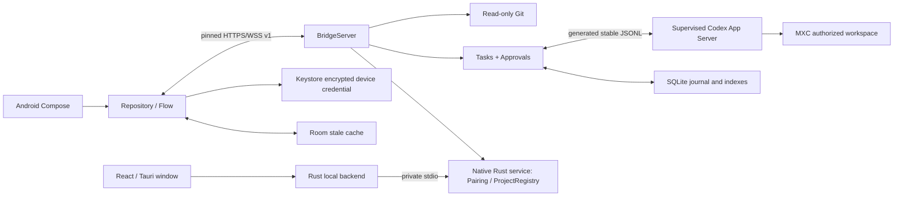

# Architecture

Installed-baseline project probes confirm that native project identities, durable thread projectId, and project/changed broadcasts can be shared between independent authenticated clients on 0.163.0-alpha.10.2. The packaged GUI itself opts out of project/changed and did not reread an external project rename in the isolated probe. Native project synchronization and desktop host cache/publication therefore require separate adapters; exposing native projects alone cannot establish desktop sidebar parity. These are isolated upstream findings, not Android or production Bridge project support. See CODEX_DESKTOP_GUI_PROBE.md for exact evidence and remaining host integration work.

The installed desktop exposes project operations internally through a renderer-scoped host projects service. Its rename operation ignores a project absent from the local cache and publishes UI changes only after the backend succeeds. A future local host adapter must resolve native/desktop identity, preserve host permissions, and verify the persisted result; a returned RPC alone does not prove a mutation occurred. No external host endpoint has been verified. Do not expose arbitrary renderer methods or write private global-state to bridge this gap.

`Rpc::project_page` now provides pinned, bounded, read-only native project pages on DesktopBaseline, with generated experimental request/response contracts and build-time fingerprints. This trusted local API retains native identities and all source fields; it is not exposed to remote clients. Core::native_project_page now filters by exact live grants for every root and maps root indices to Bridge grant IDs, rechecking authorization, directory identity and RPC generation after the read. It remains internal: device-bound pagination, cross-page consistency and desktop legacy identity mapping are still required before Android exposure. Managed requests and other experimental project methods remain rejected. See CODEX_NATIVE_PROJECTS.md.

Shared-runtime migration adds authenticated loopback-only WebSocket attachment alongside supervised stdio. Default startup remains managed-stdio on 0.159.2. Local paired environment options `AGENTDECK_RUNTIME_WS_URL` and `AGENTDECK_RUNTIME_TOKEN_FILE` select attachment through `Core::supervise_runtime`; optional `AGENTDECK_RUNTIME_PROTOCOL_VERSION` selects exactly 0.159.2 or desktop baseline 0.163.0-alpha.10.2. Remote WSS cannot configure them. The supervisor validates the actual initialize user-agent version against the selected locked schema, checks readiness and the existing permission profile, and never rewrites the attached service configuration. Reconnect rereads the bounded credential file and retains the same profile, with no fallback to a private runtime. Closing a connection never kills the shared server. The main executable verifies a matching local CLI and runs its real native boundary probe; snapshots/capabilities/diagnostics report the selected profile's version. This is not yet original-desktop synchronization: Bridge-created and explicitly imported thread indexes are available, without full upstream history projection. See CODEX_PARITY_STATUS.md for real supervisor/entrypoint evidence and remaining desktop integration work.

Windows 0.3.0 uses React in Tauri 2, a Rust desktop host and a native Rust Bridge (`desktop/core`). The host owns windows, tray, locks, native folder selection and bounded correlated IPC; the service implements TLS/WSS, SQLite, Codex, Git, pairing and approvals. Node is only a build/test tool. The former Node Bridge and WinForms/C# helpers have been removed. See [migration boundaries](TAURI_MIGRATION.md).

The first production launch binds loopback. A Windows-local QR action may save an exact private interface address; production restart restores it only while assigned and certified. No remote action can change that listener grant. The Codex child environment excludes Desktop cached PowerShell and MSIX alias paths that Windows MXC cannot execute; this does not alter the parent PATH, user login/configuration, or sandbox permissions.

Attached observation uses an explicit `sessions.observe` request for selected original threads. The Bridge rejoins already loaded native threads without model/approval/sandbox overrides, keeps desired subscriptions in memory across RPC generations, and defers unloaded sources instead of initializing their execution environment. Validated external notifications enter the bounded journal under native IDs, separate from Bridge-owned turn records. Android now merges paginated persisted items and live previews by native identity in the conversation view; this does not recover every missed event or provide complete media semantics/offline caching. See PROTOCOL.md for limits and CODEX_PARITY_STATUS.md for evidence.

## Components

The Windows Bridge runs in the logged-in user session. Rust calls Windows CurrentUser DPAPI directly with the legacy entropy identifier, preserving existing encrypted certificates. New certificates are generated with rcgen. No C# helper compiler or Node runtime ships with the application.

The Windows window has no system title bar or sidebar. Home combines Windows-local workspace sync with QR pairing; secondary management lives in the more menu. Sync discovers trusted config directories and paginated interactive thread cwd through stable config/read and thread/list, validates and deduplicates paths, then grants them only on the explicit local action. Desktop-only projects absent from these records cannot be enumerated. Sync is additive and never available over WSS. Snapshots refresh every two seconds and on durable changes; lists preserve selection and scroll. Device presence requires authenticated hello. Approval review shows full retained context, rechecks expiry after confirmation and disables duplicate submissions; the backend remains the exactly-once authority. Confirmation defaults to cancel. See DESKTOP_EXPERIENCE.md.

`desktop/core/src/protocol.rs` defines strict AgentDeck requests; Android maintains its Kotlin wire models. Pinned upstream contracts are under `packages/codex-protocol/`. Android never sends raw Codex RPC or filesystem paths. Project addition opens the native folder selector; Android can only request that local action. A session binds a project ID to one upstream thread. A turn binds one local turn ID to its upstream turn ID. Two active sessions are allowed; reservations are acquired before asynchronous starts.

## Sources of truth

The explicit Windows-local workspace sync also indexes existing authoritative threads using paginated thread/list plus loaded-list/read fallback for threads without a persisted rollout. Only exact locally granted directories are eligible. Incremental migration 4 keeps a separate session_metadata cache for provenance and relationships; upstream IDs remain unchanged and local session IDs are reused. All index changes and a sessions.synced journal event commit atomically, with local revision/event-sequence conflict checks. Attached runtimes now reconcile this index on connect/reconnect and validated thread metadata notifications through a separate coalescing worker. Runtime-generation changes and local contention reject stale snapshots; retries keep the last committed index. This is still partial: no complete live-history projection, offline deletion recovery, or loaded active-turn ownership is implied. Missing list entries are preserved instead of inferred deleted; external active states are unknown until reconciliation. Validated attached-runtime thread/deleted notifications are durably recorded in migration-5 thread_deletions. The index worker defers cache cleanup during local busy operations; cleanup and replay-safe session.deleted events commit atomically. Stale index pages skip tombstoned identities, including notification-ID reads, so deletion cannot resurrect a thread or poison subsequent refreshes. Missing/offline notifications remain an explicit recovery gap.

Codex is authoritative for execution state. `turn/start` only acknowledges submission. Only schema-validated `turn/completed` or a validated persisted turn from `thread/turns/list` establishes completed/failed/interrupted. An upstream crash or Bridge restart yields **unknown** until reconciliation establishes a terminal status. Interrupt sends `turn/interrupt`; an accepted request is not a stopped state. The observed activation race is retried only on the exact upstream error `no active turn to interrupt`.

SQLite WAL is authoritative for local project grants, session indexes, approvals, device hashes and event history. Migration 1 creates core tables; migration 2 preserves monotonic per-session sequence numbers independently of journal retention; additive migration 3 adds session_options for archive, pin and model/effort preferences without rewriting existing session rows. Events commit before fan-out. Cursor IDs are global integer strings; per-session `seq` never resets during pruning. Requests that were in-flight across restart become unknown, not safely retryable successes. Credential issuance invalidates any old device (v1 supports one paired device).

Android Room is an offline cache. The UI disables task and approval actions while stale. A Keystore AES-GCM key protects the host credential. The application repository survives activity recreation. Reconnect uses bounded exponential backoff with jitter, replays the committed cursor, falls back to a snapshot on retention gaps, and reloads session history. Event IDs remove duplicates; gaps initiate replay. Snapshot refreshes are coalesced. Conversation projection keys items by session, turn and item ID, coalesces interleaved deltas, replaces previews with completed item text, and removes replay duplicates without altering durable events. Protocol lifecycle notifications are not chat bubbles; command/file items are collapsible activities, pending approvals are inline. Task completion remains an authoritative separate result. Navigation restores the last session (or latest session on first use); drafts use saved Activity state scoped to host and conversation, clear only after acknowledged submission, and are not a persistent draft archive after force-stop. See CHAT_EXPERIENCE.md.

## Limits and recovery

JSONL frames: 8 MiB; outstanding upstream calls: 128; writes: a two-slot queue of frames up to 8 MiB each. Public inbound WSS frames: 1 MiB; at most 8 connections / 64 TCP connections; slow socket buffers close after 2 MiB and replay on reconnect. Individual journal payloads retain a maximum 256 KiB preview and explicitly signal truncation. Replay/history pages have a 512 KiB payload budget. Approval context is limited to 128 KiB. Git lists at most 2,000 safe entries; text previews are 256 KiB total. The client bounds queued events and closes/replays on overload.

Raw upstream stderr is diagnostics byte counts only, never task output. Missing/unknown methods fail closed. Pending approvals expire after five minutes, on loss of the last client, on revocation, upstream loss or restart. A disconnected device cannot cause automatic approval. Large previews and retained journals are not a complete archive of every upstream byte; the UI exposes truncation.

SQLite history defaults to 30 days with a 256 MiB retained-payload target. Authenticated settings allow 1–365 days and 16–1024 MiB, persisted in SQLite. Android confirms changes before submission. Retention runs at startup and periodically. Structural diagnostics can be exported without task content or credentials. Project content, outputs and prompts are untrusted text. No Markdown execution, remote shell API, Git write endpoint, commits or pushes exist.

Android appearance and notification preferences persist separately from host credentials. Notifications are opt-in, request the OS runtime permission, and contain generic titles only. They follow live events while the application is connected and in the background; replay does not notify. There is no background service or delivery guarantee after sleep or process termination.

Temporary local display masking lives only in the application repository's in-memory state. Event and Diff renderers apply it without changing durable events or source line calculations. Approval cards retain their full operation. No mask fragment enters persistence, saved Activity state or diagnostics; a process restart clears it.

## Local API conversations

Android ApiRepository is separate from the Bridge repository and Room cache. ApiClient sends bounded HTTPS text Chat Completions directly to the configured provider; no redirect or permissive TLS code exists. ApiSecureStore encrypts configuration and local conversations together using a distinct Keystore AES-GCM key and AtomicFile. Only explicit terminal evidence establishes success; cancellation and recovered in-flight messages remain interrupted/unknown. No API keys or API messages enter Windows IPC, WSS, Codex configuration or diagnostics. See CONVERSATIONS_AND_API.md for limits and unsupported capabilities.
