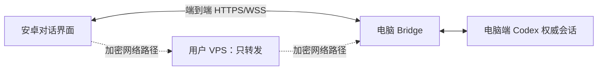

# Codex 移动与网页对话客户端规划

更新：2026-10-22。来源：用户在本聊天澄清并要求规划。当前任务是规划与代码取舍，不执行产品代码删除、部署或提交。

## 最新产品契约

安卓作为电脑端 Codex 的移动对话界面：能新建/继续会话、发送消息与图片附件、接收流式回复、同步历史、渲染图片和工具结果、查看真实完成状态，并处理会话内必要审批与问题。对话和内容呈现对齐真实 Codex；手机按移动端组织，平板保留同等会话能力。参考官方手机端效果，具体观察见 [移动端基准](../baselines/codex-mobile-2026-10-22.md)。

用户后续补充：同时提供部署后直接通过网址使用的响应式网页端，手机、平板和电脑浏览器无需安装应用或 VPN 客户端；PWA 安装为可选项。网页与安卓接入同一个电脑服务和同一份原生会话，保留安卓既有成果。网页服务的是使用入口，电脑端 Codex/Bridge 仍需在线运行。

电脑保存权威会话、运行任务、访问模型与本机工具；用户自己的服务器仅转发连接，不存储聊天、图片、任务队列或 OpenAI 凭据。安卓可缓存已加载历史；电脑离线时只读缓存，显示最后同步时间，不把未送达消息显示为已发送。服务器离线时不承诺异地可达。

这里替换的是手机到电脑的中转层。交付的是基于电脑 Codex 的个人移动客户端；ChatGPT 云端全部历史、记忆、语音及其他独立产品能力不因界面相似自动纳入，也不能通过改一个服务器地址就接管官方应用。模型能力取决于电脑已接入的 Codex 与账户。

本契约取代此前“桌面全部页面/工作台/扩展管理逐项迁移”和中间讨论中的“只读查看”。原完整计划保留在 [历史快照](../history/migration/PLAN-FULL-DESKTOP-2026-10-22.md)；旧阶段均未因此完成。本次不重编号或拆分原阶段，不以新范围绕过原提交规则，不提交或推送。

## 可行性与首要依赖

结论：自有服务器纯转发和完整移动会话体验可实现，现有代码可大量复用。真正未解决的依赖是原版桌面同一会话的可靠读取、写入及活动状态订阅，网络打通不能解决该问题。

- 现有默认运行方式是独立 managed-stdio；认证本机 WS 附着、原线程索引、历史分页、观察和资源接口已有实现。
- `desktop/core/src/server/capabilities.rs` 仍报告 `sharedDesktopRuntime:false`、`externalThreadSync:false` 和 `fullHistoryRead:false`。这说明未交付，不能单靠把标志改成 true 宣称打通。
- 以桌面原生 thread/turn/item 身份贯通安卓和电脑；桌面开始、安卓继续、桌面收到同一任务后续消息才算共享。
- 不能可靠连接正在运行的桌面任务时，明确显示不可操作/未知及原因；不自动新建平行线程，也不以新起一个服务证明共享。
- 持续开发消息和资源显示；同时保留一个集中处理的原版宿主接入事项，避免反复探测阻塞其他工作。

## 网络方案：先复用成熟转发

图中的 HTTPS/WSS 在安卓和电脑之间终止，实际跨网路径经过 VPS。VPS 不承担会话 API、数据同步或模型请求处理。

新增网页免安装要求后，推荐正式路线改为成熟反向 TCP 隧道：电脑主动连接 VPS，VPS 将指定域名/端口的 TCP 流量原样转回电脑。电脑提供网页静态文件及会话 API，浏览器打开 HTTPS 域名即可使用，网页和 WSS 尽量同源；VPS 只转发，不解密应用 TLS、不存储聊天。电脑需要持有该域名的浏览器公开信任证书，并提供证书申请/续期和隧道恢复方案。域名及 VPS 是部署前提，不是已配置事实。这样无需给手机安装网络软件，也不必自研 VPN 协议。

旧建议 WireGuard 改为可选开发验证路径：自建中心转发，复用现有固定证书 HTTPS/WSS。它需要额外客户端、占用安卓 VPN 通道，浏览器仍不能使用安卓自定义证书校验，因此不满足默认“打开网址就用”的发布要求。

反向隧道路线需要分离本机监听地址、公开访问地址与电脑身份，扩展域名 SAN、配对端点及连接恢复；安卓原配对和固定证书连接继续兼容，不能由网页适配强制注销旧安卓设备。若将网页静态文件单独部署在 VPS，则 API 仍采用电脑终止 TLS 的独立域名，并对允许的网页来源做精确授权。VPS 若终止 API TLS，便能读到流量明文，不符合此处端到端纯转发方案，不能静默采用普通 HTTPS 反向代理代替。

新增部署模板归 `deploy/relay/`，电脑连接适配归 `desktop/core/src/server/`，安卓端点与连接状态归 `core/network/` 和 `features/computers/`。这些是拟新增位置，当前没有中转实现。自建转发替代旧文档“禁止任何 public tunnel”的笼统表述，但不允许裸露 Codex 原始 RPC 或取消认证。实际部署前同步安全文档与端点合约。

## 网页端的代码与协议规划

- 新增独立 `web/` React/TypeScript 项目，采用响应式对话界面，部署静态构建到电脑 Bridge 后经 VPS 访问；也可选择单独静态站点部署。PWA manifest/service worker 可后续增强，不要求用户添加到桌面。
- 复用 Rust 会话/资源协议、历史分页、事件恢复与身份语义。提取浏览器可用的 TypeScript 传输和模型到 `packages/` 对应功能目录；不复制另一套会话数据库和业务服务。
- `desktop/src/` 当前是通过 Tauri invoke/listen 连接的电脑管理界面，不是网页聊天客户端；React/Vite 工具链和基础样式可参考，不能直接上传现有 dist 冒充 Web 对话。Kotlin Compose 渲染组件不能直接在浏览器运行，按相同消息合约实现 Web 渲染。
- 当前 `server/transport.rs` 在配对和 WebSocket 入口拒绝任何 Origin；浏览器 WebSocket 又不能像 OkHttp 一样自定义 Authorization 请求头。保留安卓原入口，新增明确的同源/允许源浏览器认证流程：电脑确认一次性配对后颁发 Secure/HttpOnly/SameSite 会话 cookie，WSS 验证会话和精确 Origin，变更请求同时做 CSRF 防护；不删除 Origin 检查，不在 URL 查询或 localStorage 放长期凭据。
- 当前 `Store::replace_device` 会撤销所有旧设备。网页与安卓并用必须增量改造设备登记、独立撤销、会话过期及并发审批行为，兼容旧配对与数据；这属于待实现的权限/身份变更，需要定向验证。
- 浏览器使用公开信任证书、标准域名校验；安卓 PinnedTrust 不能移植为网页证书豁免。消息资源沿用授权会话/资源身份，图片分块可组装为 Blob 显示，下载和缓存另定受限策略。
- Web 展示范围与上文移动会话一致：输入/附件、流式回复、图文/公式/代码/表格、工具过程、任务状态、审批和结果阅读。原始 Markdown/HTML 需清理，交互产物放隔离预览，私密会话响应不进入默认公共 PWA 缓存。
- 标签页关闭不停止电脑任务；浏览器后台连接/推送受系统限制。普通网站通知、PWA 与 Android 后台行为分别验收，不宣称网页关闭后仍保证收到通知。

网页入口和浏览器认证目前均未实现。本轮为规划补充，未开放浏览器 Origin、修改证书或权限，也未新增 web/ 工程。

## 代码保留、改造与退出主线

Android 源码根为 `android/app/src/main/java/dev/agentdeck/app/`；Rust 为 `desktop/core/src/`。以下是规划判断，不代表已删、已停用或已验收。

| 代码位置 | 决策 | 原因和实施边界 |
| --- | --- | --- |
| Android `features/conversation/` 的对话、历史、搜索、composer、messages、approvals | 保留并继续完善 | 目标核心。包含输入、流式消息、图文、引用、工具、计划、审批、追问和会话操作，不按“只是壳子”误删 |
| Android `core/data/`、`core/network/`、`core/security/` | 保留、局部拆分 | 缓存、事件恢复、去重、能力协商、凭据和证书验证仍必需；Repository 含 API/项目/设置耦合，逐项解耦 |
| Android `features/computers/`、`features/notifications/` | 保留并改造 | 配对、电脑身份与在线状态、异地连接和任务通知；通知目前不保证进程被杀后的到达，另列交付边界 |
| Android `shell/` | 保留组件，重组导航 | 手机围绕电脑/会话列表、聊天、连接设置，平板双栏；减少全桌面工作台式入口，不重写应用身份 |
| Rust `execution/`、`upstream/` | 保留并优先打通 | 同会话读写、状态、历史、资源、审批、版本约束均是壳子的后端；不因手机不执行命令而删除电脑执行层 |
| Rust `server/`、`storage/`、`authorization/` | 保留 | 配对/认证、授权索引、恢复日志、请求去重、TLS/DPAPI；纯转发服务器不持久化不意味着电脑端也不能存储 |
| `desktop/src/`、`desktop/src-tauri/` | 保留精简电脑管理入口 | 托盘、服务生命周期、授权、二维码、撤销与连接诊断仍有用；无需重做第二个桌面 Codex，也不能整目录删除 |
| Android `features/api/` 的四个文件及专属测试 | 优先删除候选 | 目前是独立直连 Chat Completions 文本客户端，形成第二套凭据/历史，与电脑 Codex 会话不是同一路径；先移除 Ui.kt/API 入口和 Repository.apiRepository 引用，保留用户数据，不连带删除 Vault |
| Android `features/settings/`、Rust `settings/` | 保留会话必要部分；高级管理退出当前主线 | 保留主题、字号、通知、连接、缓存、模型/强度/权限所需配置；账户只读用量可保留为附加项，插件/MCP/hooks/服务端配置管理不再是完成条件 |
| Android `features/skills/`、Rust `settings/skills.rs` | 区分会话与管理 | 输入框的技能引用及结果展示可以保留；技能启停和详细目录管理页退出首要范围，不能误删 composer 对 skill 的支持 |
| Android `features/projects/`、Rust `projects/` | 保留身份、授权、会话归属、附件和引用预览 | 项目可作为新对话的运行环境；文件选择/引用、资源权限依赖这些代码。完整项目管理与通用文件管理不是移动壳子前置条件 |
| Android `features/review/`、Rust `projects/git.rs` | 保留渲染组件，独立工作台退出主线 | 官方演示有任务内改动与 Diff 阅读，应复用 DiffLines/DiffPane；现接口是当前 working-tree，不是任务对应历史 Diff，需要单独关联，不把工作区变化当任务结果 |
| Android `queue/`、SessionGoal 等会话扩展，Rust 对应接口 | 暂保留、能力协商显示 | 已有代码且属于可用会话操作，当前不足以证明应删除。高级队列/目标编辑不阻塞基础收发和渲染；显示计划/目标进度仍保留 |
| `packages/codex-protocol/`、锁文件、构建/发布、权限/恢复/消息测试 | 保留 | 真实协议与兼容性基础，不按文件多或名字“desktop”批量删除 |
| 脚本/历史证据/旧全桌面计划 | 分类保留，低频资料归档 | 原版会话接入探测与协议审计仍有用；停止重复全桌面页面盘点，不删除已有事实或伪造缺口消失 |

实际删除顺序：先完成代码引用清单 → 退出导航与命令/设置搜索入口 → 删除只服务退出功能的实现及专属测试 → 清理仅由它使用的依赖和文档 → 批量编译。共用消息、图片、权限或资源组件一律按依赖判定；不在本次规划中执行删除。

当前 git status 中大量 D 与 ?? 来自既有按功能移动，不能当作待清理废文件。保留应用 ID、Kotlin 包、Room、序列化和 Rust 公开入口；既有 API 加密数据不主动清除，不批量删 tests 或 schema。

## 对话与渲染的交付内容

| 内容 | 已有事实 | 必须补齐的体验 |
| --- | --- | --- |
| 会话列表/历史 | 原线程索引、分页、归档、搜索、关系导航有代码 | 桌面真实内容与身份一致，历史加载无漏项/重复，外部变更和断线补齐 |
| 消息输入 | 文字、附件、模式、模型、强度、权限、草稿已有 | 发送中/已接受/未知/失败区分，草稿可靠恢复，新建/继续/停止/追加可用；自动重试不能重复提交 |
| 图片上传 | Android Composer.kt 和 Rust composer.rs 总附件大小均为 512 KiB | 分块上传与受限资源存储、进度/取消/校验；限额按真实模型能力协商，不只修改 UI 常量或直接调大所有帧 |
| 图片展示 | SessionImages 有查看按钮、读取和缩放；Rust 仅支持授权项目内部分本地来源，最大 8 MiB | 对话内缩略图、点击大图、保存/分享、加载/错误、缓存；补用户图片、生成图、工具图和消息引用的来源覆盖 |
| Markdown/代码/表格 | Markwon core + tables；代码块可展开复制 | 正确排版、代码高亮、横向表格、数学公式、流式重排及长消息性能；当前未配置图片/公式插件，不能宣称完整渲染 |
| 工具与代理内容 | 工具结果、活动、计划、子代理、引用与长内容阅读已有 | 可折叠活动组与时间线、命令/输出/状态、任务相关文件和 Diff；未知类型可读且不丢字段 |
| 资源与链接 | 分页/分块、哈希核验和项目引用预览已有 | 资源身份稳定、历史文件变化有明确状态；远端图片及项目外资源需来源授权规则，不能任意抓 URL 或开放文件路径 |
| 交互内容与媒体 | 有问题/审批及部分内嵌图片，部分音频只显示元数据 | 真实来源可用的音视频、文件、产物/交互卡片逐类建立展示或预览；网页/HTML 类产物使用隔离预览，不能执行任意消息脚本。语音输入/实时语音另列扩展，不把“渲染一致”缩成纯文本 |
| 任务状态与通知 | 有上游终态、重放与通知过滤代码 | 运行/排队/等待审批或回答/完成/失败/停止/未知/离线一致；只有权威终态才算完成，通知能回到原会话 |

“和真实 Codex 一样”按会话的输入、内容类型、显示效果和交互结果验收。官方演示未覆盖的图片、公式和媒体不猜测其已支持程度，使用同一份真实电脑输出做 Android 对照；消息显示不要求把电脑的工具管理设置搬到手机。

## 连续实施顺序与验收

以下是工作顺序，不是新增 Git 提交阶段；保留大范围连续开发和集中验收规则。

1. 收敛入口和共享接入：保留已有程序，优先拆掉独立 API 导航耦合；用已有原线程路径补齐真实桌面同一会话收发/状态，集中记录宿主阻塞。接入和消息界面可独立推进，不假造接入成功。
2. 打通自有服务器路径：完成反向 TCP 隧道部署模板、公开域名/电脑证书/配对端点适配和浏览器会话认证；在手机蜂窝网对电脑另一网络验证。默认不要求手机安装 VPN，确认远程流量经用户 VPS 且应用 TLS 在电脑终止。
3. 成套完成移动对话：安卓保留既有实现；新增响应式 Web/PWA，先贯通浏览器端的会话列表、新建/继续、输入框、流式文本、状态、审批/问题与恢复。两端共用协议与验收样例，手机优先，小屏和平板不挤掉必要操作。
4. 完成富内容：分块附件、消息内图片、Markdown/公式/表格/代码、工具活动、引用、文件/Diff 与产物预览；按真实消息类型对照，集中做性能和缓存处理。
5. 集中验收和清理：以真实电脑 Codex + VPS + 安卓/浏览器完成全链路；覆盖 Chrome/Android 浏览器、桌面浏览器和 Safari/iOS 的关键交互。验证无需安装 App/VPN 即可访问，两端独立授权并操作同一会话，域名证书续期/Origin/CSRF/撤销与恢复正常；再移除无引用的候选模块、更新说明和部署指引。仅当前有用代码和必要测试进入未来提交，不混入既有独立 CI/发布改动。

验收用例必须覆盖：桌面原会话在安卓继续，电脑收到同一身份消息；手机发送文字和多张正常大小照片，看到流式回复/图片/工具和权威终态；电脑端外部发消息可在手机同步；蜂窝网/局域网切换、VPS 重启、电脑睡眠、应用进程重建后不重复发送；图片变更/失效有反馈；旧配对和数据可升级；服务器无聊天/媒体落盘，日志无内容/凭据，端到端 TLS 身份仍正确。

关闭安卓后电脑任务继续；后台完成通知单独验证。当前无进程被杀后的通知保证，若需要可靠推送，再设计仅携带通用唤醒信号的可选机制，不能把中转扩成聊天存储服务。

本轮实际检查：阅读现有架构与功能代码、依赖和协议边界，查看官方网页交互演示及远程连接文档。未运行编译/业务测试、真实模型、手机安装、服务器部署或真实桌面共享验证；本轮只有规划文档改动。
